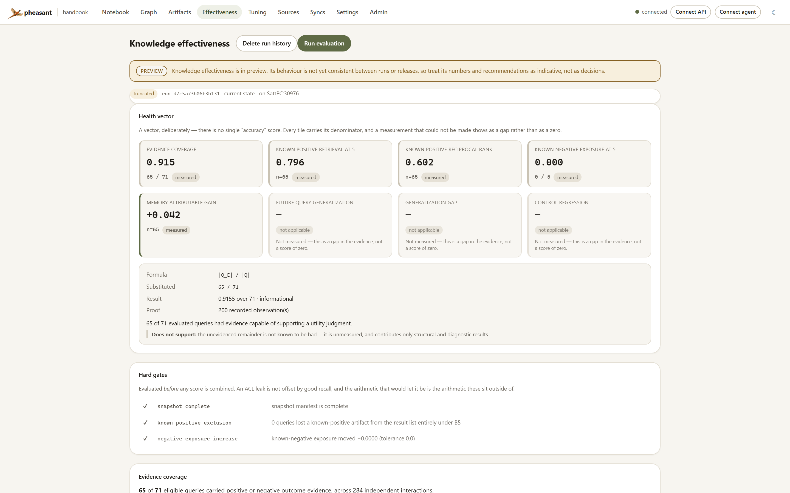
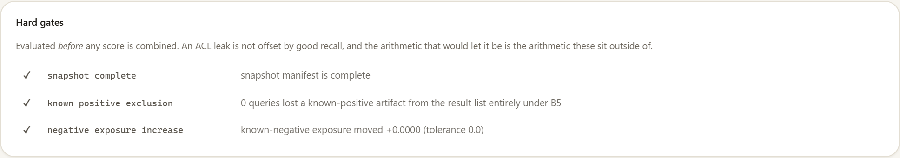
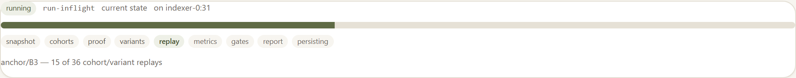
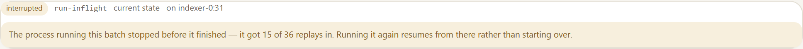

# Knowledge-effectiveness evaluation

> Off by default. Read-only when on. Publishes no single "accuracy" score.

pheasant indexes documents, repositories, graph relationships and append-only
memories through one deterministic retrieval pipeline. The evaluation plane
answers a different question from "did the sync work": **is this knowledge base
getting better, and how would we know?**

The claim it is built to support is deliberately narrower than "our knowledge
base is 94% accurate":

> pheasant observes how knowledge is retrieved and used, records the strength
> and limits of that evidence, evaluates each reproducible state against fixed
> and current query cohorts, attributes changes to memory and steering
> interventions, explains every calculation, and promotes learned behaviour only
> when it improves independently evidenced outcomes without violating temporal,
> security or control invariants.

That is a smaller claim and a true one. The rest of this page is how it is kept
true.

---

## The boundary

An evaluation record is **about** the knowledge base and is never part of it.
Nothing this plane writes is a file, is chunked, is indexed, or is returned by
an ordinary search. It is the same boundary
[the observation plane](observation-and-formation.md) draws, and it is drawn again here
because the temptation is stronger: an evaluation report *reads* like knowledge.

```
query + policy + principal
        │
        ▼
 retrieval trace ─────────────► interaction ledger ──┐
        │                                            │
        ▼                                            ▼
 response + citations                       typed interaction proof
                                                     │
 corpus + graph + indices + memory                   │
        │                                            │
        ▼                                            │
 immutable snapshot manifest ◄───────────────────────┘
        │
        ▼
 cohorts × baseline/ablation matrix
        │
        ▼
 deterministic replay  (the real search path, never a re-implementation)
        │
        ├─► required health metrics      ├─► hard gates
        ├─► memory attribution           ├─► operational metrics
        │
        ▼
 evidence-bearing report ──► end-user │ agent │ developer  +  candidate decisions
```

---

## Three ideas that decide everything else

### 1. Exposure is not success

An artifact appearing in a result list is *exposure*. It is not evidence that it
helped. A system that scores itself on what it chose to show has measured its own
confidence, and its "precision" improves whenever it returns fewer results.

So served, cited, selected, accepted, rejected and validated stay distinguishable
all the way through, and only the caller can say which happened:

```bash
pheasant eval taxonomy
```

| Event | Polarity | Strength |
|---|---|---|
| `served`, `considered`, `included_in_context` | unknown | weak/moderate |
| `cited` | positive | weak |
| `selected` | positive | moderate |
| `explicit_accept`, `downstream_success` | positive | strong |
| `deterministic_validation_pass` | positive | **conclusive** |
| `explicit_reject`, `downstream_failure` | negative | strong |
| `deterministic_validation_fail` | negative | **conclusive** |
| `explicit_correction`, `superseded` | negative (current-time only) | strong |
| `not_selected`, `immediate_reformulation` | **unknown** | weak |

`not_selected` is the important row. The reader may have found the answer at rank
one and stopped. Treating silence as a negative manufactures negatives at exactly
the rate the region serves results.

### 2. Unknown is a value, not a missing one

An artifact with neither positive nor negative proof is **unjudged** and stays
that way. Metrics count judged items only, and every one of them is published
beside its evidence coverage, so "0.89" is never mistaken for a claim about the
whole corpus.

A metric whose inputs are absent reports `insufficient_evidence` with
`value: null` — never `0.0`. The difference is between "we could not measure"
and "we measured badly", and a dashboard that cannot show the first trains people
to ignore the second.

### 3. Learned is not generalization

Replaying the queries whose interactions *created* a memory and reporting the
improvement as "the memory helped" measures recall of the exact experience the
memory was minted from. It always looks excellent.

So they are separate cohorts, with separate metrics, that the report never
merges:

* **learned** — queries that contributed the intervention's evidence. Reported
  as `learned_query_gain`, labelled *recall of learned experience*.
* **temporal holdout** — queries asked *after* the intervention existed, which
  contributed none of its evidence. Reported as `future_query_generalization`.
* **`generalization_gap`** — the difference. A large positive gap means
  memorization without transfer, and it is not a reason to promote anything.

---

## Recording evidence

Retrieval already records what it served. Only the caller knows what came of it.

**HTTP**


```bash
curl -X POST localhost:8765/evaluation/evidence -H 'content-type: application/json' -d '{
  "query": "where is invoice retry configured",
  "target_id": "file:docs:invoice.md:branch=none",
  "event_type": "explicit_accept",
  "principal": "user:ada",
  "session_id": "s-91"
}'
```

**MCP**


```
record_evidence(knowledge_base="kb", query="…", target_id="…",
                event_type="selected")
```

**CLI**


```bash
pheasant eval proof --query "…" --target "file:docs:invoice.md:branch=none" \
                    --event explicit_accept
```

The response shows the weight **and its four multipliers** (type, strength,
temporal, source), because a reader shown only `0.25` cannot tell a conclusive
outcome decayed by a year from a fresh citation.

Two things are derived without anyone reporting them: exposure, from the
interaction ledger (polarity unknown, weight zero), and an `explicit_accept`
against any memory record promoted from an admitted candidate — somebody looked
at the evidence and said "yes, remember that".

---

## Running a batch

```bash
pheasant eval run                      # current-state replay
pheasant eval run --mode historical --as-of 2026-06-01T00:00:00Z
pheasant eval report                   # the last one
pheasant eval trend --metric known_positive_reciprocal_rank
```

Over HTTP, `POST /evaluation/run` starts a background job and returns its id —
a run is minutes of work on a real corpus, far past what a request should hold
open — and `GET /evaluation/report` returns the whole document.

### What a run does, in order

1. Resolve the evaluation time (current state, or a historical reconstruction).
2. Build the **snapshot manifest**: content, graph, index, encoding, chunking,
   fusion, memory, ACL and evaluation-policy digests.
3. Resolve **cohorts** — re-using the frozen anchor rather than rebuilding it.
4. Project **proof**, capped at the evaluation instant so a historical run
   cannot read evidence from its own future.
5. Generate the **variant matrix**.
6. **Replay** every cohort under every variant, through the real search path.
7. Compute required metrics; enforce evidence sufficiency.
8. Compute enabled diagnostics, within budget, labelled as diagnostics.
9. Compute **paired deltas**, matched by query id.
10. Evaluate **hard gates** — before any aggregation.
11. Generate the three explanations from the one result.
12. Persist an append-only run manifest, per-query results and aggregates.
13. Decide each candidate: promote / retain / insufficient evidence.
14. Publish the trend point.

---

## The ablation matrix

An ablation is valid only when the intervention is the *only* difference between
the paired runs. Every variant names its baseline explicitly.

| Id | Memory passages | Alias | Preference | Exclusion | Isolates |
|---|---|---|---|---|---|
| `B0` | off | – | – | – | the corpus alone |
| `B1` | on | – | – | – | memory as content |
| `B2` | off | ✓ | – | – | vocabulary adaptation |
| `B3` | off | – | ✓ | – | preferred-source ranking |
| `B4` | off | – | – | ✓ | noise suppression |
| `B5` | on | ✓ | ✓ | ✓ | the memory system entire |
| `B6` | on | ✓ | ✓ | ✓ + candidates | proposed interventions |

`B2`–`B4` hold memory *content* off deliberately: a steering rule is measured by
what it does to corpus ranking, and running it with passages on would let a
retrieved memory record take a slot and be counted as the rule's doing.

---

## What comes out



A **health vector**, not a scalar:

```yaml
health_vector:
  evidence_coverage:              {value: 0.44, numerator: 46,  denominator: 103}
  known_positive_retrieval_at_5:  {value: 0.89, numerator: 40,  denominator: 45}
  known_negative_exposure_at_5:   {value: 0.03, numerator: 7,   denominator: 225}
  memory_attributable_gain:       {value: 0.09, denominator: 44}
  future_query_generalization:    {value: 0.03, denominator: 12}
  generalization_gap:             {value: 0.06}
  control_regression:             {value: 0.00, denominator: 38, status: pass}
```

Every entry carries its status and denominator. A metric that could not be
computed appears with `value: null` rather than being dropped, because a vector
that silently loses a dimension reads as one where that dimension was fine.

Each metric also carries its formula, its substituted calculation, its operands,
its proof references, what was excluded and why, and one explicit limitation. A
result that cannot state all of those is **withheld** rather than published with
them missing, and the omission is logged as a bug.

### Three readers, one result

* **End user** — what changed, against what, with the concrete numerator and
  denominator, the evidence coverage, and one material limitation.
* **Agent** — status, evidence sufficiency, deltas, proof references, the limits
  of what may be concluded, and the actions this report permits. The action list
  shrinks to inspection alone whenever a gate fails.
* **Developer** — snapshot diff, cohort membership, per-query operands, formulas
  with substitutions, excluded queries and reasons, and the **worst
  regressions** rather than the mean.

They are projections of the same record. The moment the prose is computed
independently of the numbers it can disagree with them — and the prose is the
part people read.

---

## Hard gates



Gates are not metrics with a strict threshold. Metrics are combined, and anything
combined can be offset: an ACL leak paired with excellent recall produces a
healthy-looking composite, and that composite is a lie about a security failure.

| Gate | Asserts |
|---|---|
| `acl_leak` | A scoped record does not reach a principal who did not write it. Reports *not evaluated* when `security.acl_enforced` is off — scope isolation is not in force there, and failing every default region would train people to ignore the gate |
| `stale_current_leak` | A superseded record is not returned under `current_only` |
| `temporal_invariant` | The same query under `as_of` **does** bring the old record back |
| `abstention` | A query about content the corpus never held returns nothing |
| `known_positive_exclusion` | No exclusion removes a demonstrated-useful artifact |
| `control_regression` | Queries the intervention should not touch did not move |
| `negative_exposure_increase` | Known-bad content is not served more often |
| `snapshot_complete` | Every manifest digest resolved |

The first four run against the **synthetic invariant cohort**, whose cases are
derived from this region's own memory records — a fixed case list would pass
everywhere and mean nothing anywhere.

---

## Candidate promotion

[Memory formation](observation-and-formation.md) already proposes candidates. What was
missing is the evidence a promotion decision could be made *on*, and the
guarantee that gathering it cannot itself change what production returns.

```
observed evidence → proposed → candidate → shadow validated → active
                                        ↘ retained | insufficient evidence
```

A candidate is measured by passing its rule into the search call for the length
of one query, through the same `parse_rule`/`admits` path a stored rule takes.
Nothing is written, so a candidate cannot reach production ranking by being
evaluated.

Promotion requires, all of them:

* every hard gate passing;
* at least `minimum_independent_queries` queries the candidate was **not**
  derived from;
* a temporal-holdout result — learned-query performance cannot stand in for it;
* control regression and negative-exposure increase within tolerance.

`evaluation.promotion.enabled` is off by default, and with it off the same
decisions are computed and recorded and nothing is applied. Run it that way
first.

A proposed **fact** comes back as `not_shadow_replayable`: its text is in no
index, so no arm can return it, and scoring the candidate's own text against the
query would measure string similarity and report it as retrieval.

---

## Watching a batch, and what happens when the container stops

A batch is minutes of work. Two things follow from that, and both are why the
run's progress is a **row in `/state`** rather than an object in the process
running it.

### Progress is readable from anywhere

```bash
pheasant eval status            # once
pheasant eval status --watch    # until it reaches a terminal state
```

```
running      [##########..............] 42%  replay — anchor/B3  (15/36 replays)
  run run-0664e4863d7b482c on indexer-0:31
```



Over HTTP, `GET /evaluation/status`; over MCP, `get_evaluation_status`; in the
UI, the **Effectiveness** page polls it while a run is in flight. All four read
the same row, which is what makes them work in the two cases that actually
happen: a browser talking to an API replica that did not start the run, and a
reader coming back after the container that *was* running it was restarted.

`phase` names the step the batch is on — `snapshot`, `cohorts`, `proof`,
`variants`, `replay`, `metrics`, `gates`, `report`, `persisting` — and
`completed_units`/`total_units` count **(cohort, variant) replays**. Counting
pairs rather than queries is what keeps the bar honest across cohorts of very
different sizes: one that jumped 40% for the six-case invariant cohort and
crawled through the anchor would be measuring the wrong thing.

### A stopped container is reclaimed, not left spinning

Nothing rewrites a row when a process is killed, so something else has to. A
run whose heartbeat has expired is marked **`interrupted`** — with how far it
got and why — by `reclaim_interrupted_runs`, which runs at API startup and on
the scheduler beat.



`interrupted` rather than `failed` is a real distinction: the batch did not
fail, it was cut off, and that decides whether resuming it makes sense. It
does.

### Restarting resumes rather than starting over

Each **(cohort, variant)** replay is checkpointed to `evaluation_replays` the
moment it finishes — not batched at the end, because a container stopped
between two replays must keep the one that completed. Re-running the same batch
re-derives the same content-addressed `run_id`, loads the checkpoints, and
replays only what is missing:

```
$ pheasant eval run
  resuming: attempt 2; 3 replay(s) already done
  replay: anchor/B0 (checkpointed)
  ...
completed    [########################] 100% completed  (36/36 replays)
```

The checkpoints are cleared **only once the report is committed** — they are
the recovery path for a run that did not get that far, and dropping them
earlier would mean a crash during persistence had to replay everything again.

A resumed run computes the *same numbers* as an uninterrupted one; the test
suite asserts it by running two identical regions, killing one mid-batch, and
comparing health vectors. Reproducibility cannot depend on whether the
container happened to restart.

| Terminal state | Means | Re-running it |
|---|---|---|
| `completed` | Everything replayed, report published | No-op — it is history, and re-running would destroy the report |
| `truncated` | Ran out of `maximum_queries_per_run` or `maximum_runtime_seconds` | Same; raise the budget first |
| `interrupted` | The process stopped without finishing | **Resumes** from checkpoints |
| `failed` | The batch raised | **Resumes** from checkpoints |
| `invalid` | The snapshot manifest was incomplete | Fix the manifest gap first |

---

## Sizing an evaluation node and its volume

`pheasant scan` reports it, because that is the moment somebody is provisioning:

```
evaluation plane (region-wide)
  at full cohorts (200 queries x 6 variants x 6 cohorts): 7,200 replays/run, ~1.0 min
  storage: ~47 MB per run (~17.1 GB/yr at the configured cadence), 5.8 MB of replay
           checkpoints in flight
  suggested container memory for a batch: 0.5Gi
```

Three numbers, and they answer different questions:

* **Run time** is `queries × variants × cohorts` replays, each a real search
  through the real hybrid path. Linear, and the only term worth tuning.
* **Steady state** is metric rows and reports, which accumulate. It is an
  *upper bound*: per-query rows exist only for queries carrying positive proof,
  so a region where a quarter of queries are evidenced uses roughly a quarter
  of it. The bound points that way on purpose — over-provisioning a volume is
  cheap, running out mid-run is not.
* **Peak** is the replay checkpoints held *during* a run and deleted when it
  completes. This is free space a volume must have, which is a different
  question from what it fills with.

The coefficients live in `src/pheasant/capacity.py` — the one place sizing
numbers live, so `pheasant scan`, `pheasant shard plan` and these docs cannot
disagree — and they are measurements rather than guesses. Reproduce them on
your own hardware:

```bash
python -m pheasant.evaluation.benchmark --output evaluation-capacity.json
```

It runs a real batch through the real search path and prints what it measured
beside what the model projected. The shape holds across machines; the constants
move. CI runs it on every change to the plane and publishes the comparison as a
job summary, because a model nobody checks against a machine is a model that
quietly stops describing anything — and the first two coefficients shipped here
were out by 2x and 3x, found exactly this way.

### Scaling

Evaluation does not scale by adding workers, and
[the section below](#why-replay-is-not-fanned-out-over-the-worker-transport)
says why. It scales by:

* **fewer queries** — `evaluation.cohorts.maximum_queries_per_cohort`;
* **a longer interval** — `evaluation.minimum_interval_seconds`, or leaving
  `on_material_snapshot` off and running it by hand;
* **fewer variants** — trimming `evaluation.variants` (`B0` is not removable);
* **sharding the region** — past the point where a batch will not fit a budget
  worth having, `pheasant shard plan` splits the corpus and each shard
  evaluates itself.

---

## Running it in a fleet

The evaluation plane is read-side work and is shaped for the
[role split](how-to/worker-fleet.md):

* **One run per `/state`.** A batch claims the `__evaluation__` lease through
  the same conditional-`UPDATE` mechanism source leases use, so several API
  replicas produce one run rather than N. A replica that dies mid-run stops
  heartbeating and the lease goes stale.
* **Reclaiming a run frees its lease.** A killed container releases nothing, so
  it leaves the lease row behind, and the run row and the lease row age out on
  two different clocks — `evaluation.run_stale_seconds` and the source lease's
  own 45s window. Where the first is set *below* the second, the region reported
  a batch `interrupted` — which invites a resume, and the UI says so — and then
  declined the resume, because a lease nobody held said someone was running it.
  Reclamation now frees the lease on the same evidence and in the same window
  that declared the run dead, so "interrupted" always means the next attempt
  runs. A lease that is still beating is never touched: the staleness test is
  in the `DELETE`, so a successor that legitimately took it survives.
* **Never under `sync_lock`.** The scheduler holds that across all its work; a
  thousand-query replay inside it would stall incremental sync for every source
  — the same mistake the observation plane's hot-to-cold Parquet roll was moved
  outside the lock to avoid.
* **Automatic triggers fire only where the scheduler runs** (`all`, `indexer`).
  `api` replicas serve requests and must not spend their budget replaying
  cohorts; they can still start a run on request, because an operator asking for
  a report is not background work.
* **Bounded.** `maximum_queries_per_run` and `maximum_runtime_seconds` cap a
  batch, and a truncated run names the cohort/variant pairs it dropped rather
  than reporting a smaller denominator as if it were the whole cohort.
* **No write on the read path.** The replay searcher runs with
  `usage_tracking=False`: crediting a replayed retrieval as a *use* would let
  evaluation inflate the salience of the records it is measuring.

### Why replay is not fanned out over the worker transport

The fleet already has a service-to-service path — `sync.concurrency.worker_transport`,
HTTP or gRPC, with pooled connections, batching, circuit breakers and deadline
propagation. Replay does not use it, deliberately.

That transport carries **preparation**, which is an *optimization*: no
arrangement of worker failures may change what a sync produces, so a hop that
fails can fall back to local preparation and the result is identical. Replay has
the opposite contract. It is a *measurement*, and a measurement that fell back
to a different execution path would be measuring the fallback. Fanning a cohort
across workers would also introduce exactly the two things a reproducible run
cannot have: per-worker variation in what is in the index at the moment each
query runs, and a result whose composition depends on which worker answered.

So a batch runs in one process, against one snapshot, bounded by
`maximum_queries_per_run` and `maximum_runtime_seconds`. Scale here is *fewer
queries per run* or *a longer interval*, not more workers — and a region large
enough to need more than that is a region `pheasant shard plan` should be
splitting, at which point each shard evaluates itself.

---

## What this deliberately does not do

* **Prove exhaustive recall.** No partial judgment set can. Every recall-shaped
  metric is named `known_positive_*` so its scope travels with it.
* **Treat embedding proximity as truth.** Geometric diagnostics are classified
  `diagnostic` and may never enter a factual-accuracy claim.
* **Publish a default composite.** `evaluation.composite_weights` is empty by
  default. Configured, it is a weighted geometric mean that excludes (never
  zero-fills) missing components, renormalizes over what was available, reports
  which those were, and is labelled *not factual accuracy*.
* **Promote anything on its own evidence.** See above.

---

## Where this differs from the specification, and why

Four deliberate deviations. Each is a narrowing or a correction, and each is
recorded here rather than left for someone to discover from the code.

**Snapshot ids are content-addressed, with no instant in them.** The spec's
shape is `kb-<instant>-<digest>`. A clock in the id means two runs an hour apart
over an unchanged region produce two snapshots, which makes "the same snapshot
and configuration produce the same result" untestable and turns
`ON CONFLICT DO NOTHING` from idempotency into an accident of two runs landing
in the same second. The instant lives in `created_at` / `effective_as_of`, where
it describes what it actually is. `effective_as_of` is deliberately *not* in the
digest either: a historical reconstruction reads the same indexed state under an
earlier proof cutoff, and putting its instant in the id would claim the corpus
differed when it did not.

**Run ids are deterministic too, for the same reason.** A run is its
`(state, configuration, mode, described instant)` tuple: two `pheasant eval run`
invocations over an unchanged region produce identical numbers, so they are one
run and one trend point rather than two identical ones. A historical
reconstruction over the same state *is* a different run, because the proof
cutoff differs. The clock-seeded version made two runs a second apart into two
rows and two runs *within* a second silently collapse into one — the worst of
both, caught by running the batch twice against a real Postgres.

**And a batch that already answered is skipped, not replayed over.** The second
invocation reports `skipped`, hands back the stored report and its gates, and
does no work — so an hourly beat over a region that has not changed costs one
row read rather than a full cohort-by-variant matrix. This used to only decline
to *rewrite* the row while replaying anyway, which broke three things at once:
the row said `completed` while a batch was genuinely in flight (so every
watcher read a live run as finished, with a `fraction` that fell from 1.0 back
toward zero), `active_run` could not see it because it filters
`status='running'`, and a process that died there left the row `completed` with
`phase='replay'` forever — unreclaimable for the same reason, with orphaned
replay checkpoints nothing would load or clear. `failed` and `interrupted` are
excluded from this: both mean the batch did not finish, and picking one up
again is exactly what the checkpoints are for.

**Only steering candidates are shadow-replayed.** A proposed alias, preference
or exclusion rule is exercised exactly, through the real `parse_rule`/`admits`
path. A proposed *fact* is reported `not_shadow_replayable`, because its text is
in no index and scoring it against the query would measure string similarity and
report it as retrieval. This is what the formation rules actually produce —
`alias-cooccurrence-v1` and `path-affinity-v1` are rules; the session digest is
written directly rather than proposed.

**Leave-one-out exclusion is an over-fetch, not a re-index.** Attribution for a
single record removes its hits from a list the region really produced: the
searcher is asked for `k × 3` and the list is truncated to `k` *after* exclusion,
so the freed slots are refilled from real ranked candidates. Fusion scores are
unchanged and a hit from beyond the widened window still does not enter, so it
approximates "the record was never written" rather than reproducing it. The
report says so instead of implying the exclusion was exact.

**Control regression is paired against `B1`, not the corpus baseline.** The
cohort is defined by "no steering rule fires here", so the treatment it
controls has to be steering alone — and `B1` (memory content, no steering)
against `B5` (content plus every steering kind) differ in exactly that. Pairing
it against `B0` compares steering *and* memory content, so a record
legitimately answering a control query read as an unintended regression: the
treatment doing its job, counted as harm.

Widening the cohort to exclude anything memory could answer was the other wrong
fix, and it emptied the cohort outright — a formed session digest quotes the
very queries the cohort is drawn from, so retrieval returns it for all of them.
Both were found by running a real region and reading its gates.

**Control regression counts only evidenced control queries.** An earlier version
counted any movement in an unjudged control query's top-k, and it fired
immediately on a region whose memory records legitimately matched a control
query: the ranking changed, nothing said it changed for the worse, and the gate
failed anyway. Counting "different" as "worse" is the over-claim this whole plane
refuses. Unjudged control queries are reported separately as `unjudged_changed` —
a real observation about blast radius, published as the unmeasured thing it is.

The **optional geometric pack** (§17 of the specification: PCA residual,
Mahalanobis distance, subspace alignment, graph diffusion, optimal transport)
and the **response-surface pack** (BLEU, GLEU, METEOR, token F1) are not
implemented. Both are labelled optional and diagnostic there, both require a
frozen encoding profile or a reference response this region does not have, and
neither may enter a factual-accuracy claim. The classification machinery they
would need — `Classification.DIAGNOSTIC`, the optional-pack config switches, the
"never a correctness measure" labelling — is in place, so adding one is adding a
function to the registry rather than a design.

## See also

* [Memory formation](observation-and-formation.md) — the observation plane this reads
* [The memory system](artifact-records.md) — validity, steering, tiers
* [Configuration](configuration.md#evaluation-knowledge-effectiveness-measurement-optional)
* [HTTP API](reference/http-api.md) · [MCP tools](mcp_tools.md)
