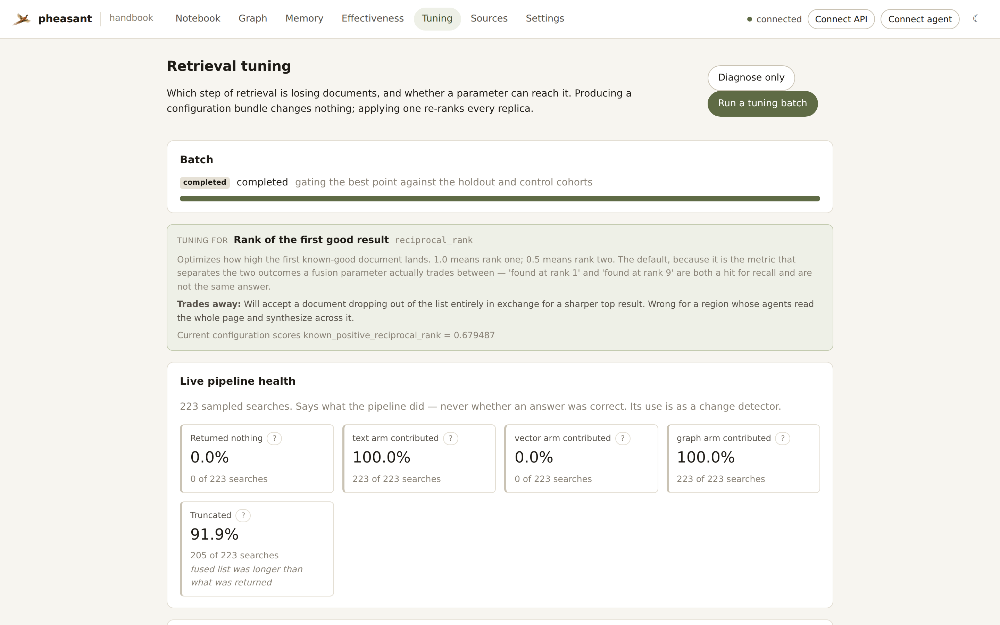
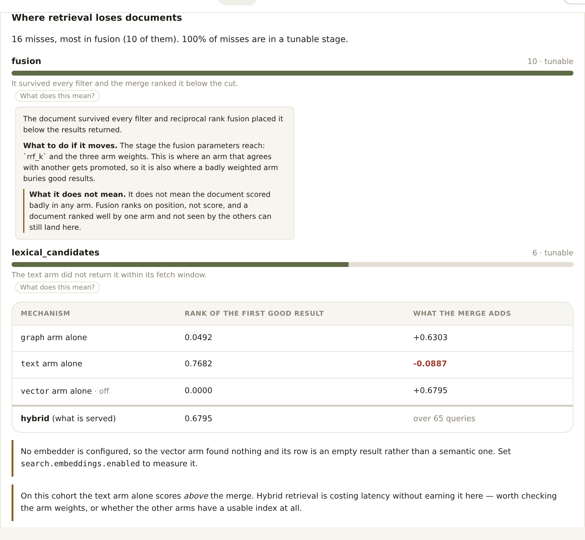
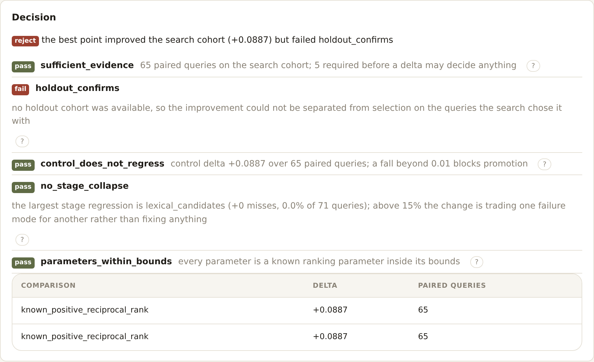
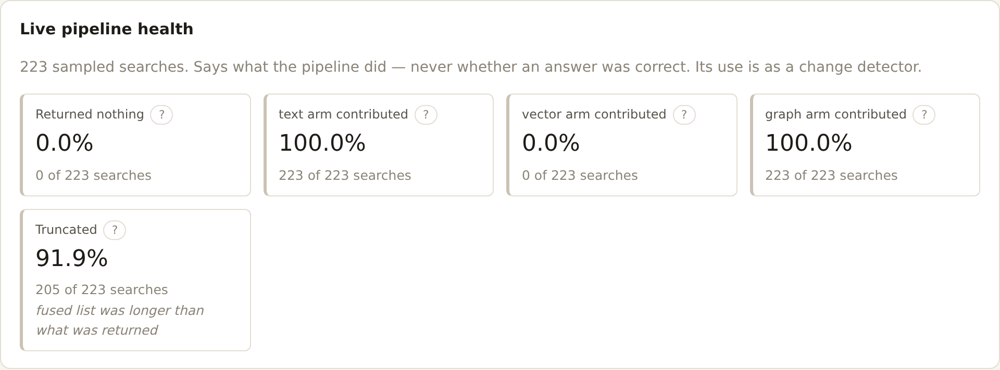
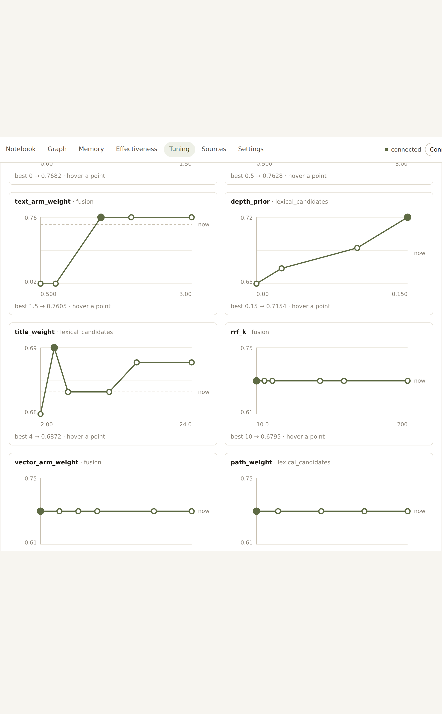
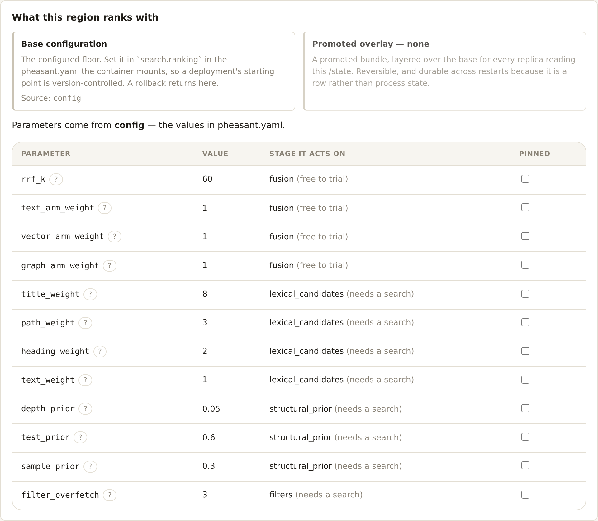

# Retrieval performance tuning

Off by default (`tuning.enabled`), and read-only when on unless you apply a
bundle.

The [evaluation plane](knowledge-effectiveness.md) tells you *how well*
retrieval is doing. It does not tell you **which step is failing**, and it
cannot: `known_positive_recall_at_10 = 0.61` is a number about the region, not
about a stage.

That distinction is the whole reason this exists. Retrieval is a pipeline —
query analysis, three independent candidate arms, three filters, a fusion, a
truncation — and after the merge every one of those failures looks identical,
because they all produce the same thing: an absent result.

**Six causes, one symptom.** And they call for opposite responses:

| The document… | The fix |
|---|---|
| is not indexed | look at sources, includes, extraction — no ranking parameter helps |
| was never returned by the lexical arm | column weights, structural priors, the query itself |
| was returned and a filter removed it | ACL, memory policy, section — or the over-fetch window |
| survived the filters and fusion ranked it 47th | the fusion constant, the arm weights |
| fused 11th with `max_results: 10` | the caller asked for too few results |
| was returned | nothing failed |

Guessing between those costs days. So the first thing this plane produces is
not a tuned parameter — it is the histogram.

---

## The four movements



A batch is four phases, each a durable artifact rather than a step inside a
function, because each one is independently useful and each is somewhere you
might reasonably stop.

### 1. Diagnose

Replay a cohort through the **real** search path with `explain=True`, and
attribute every miss to the **first** stage that lost the document.



```
pheasant tune diagnose
```

```
  8 evidenced query/target pairs, 4 served
    lexical_candidates        2  ##          (tunable)
    fusion                    2  ##          (tunable)

  4 misses, most in lexical_candidates. 100% of misses are in a tunable stage.
```

Three things it refuses to conclude, and each refusal is load-bearing:

*It never infers absence from the corpus.* "No arm returned it" and "it is not
indexed" are different claims, and the second needs a lookup rather than an
inference. Without one it reports `candidates_missing` — an honest "no arm had
it, and I did not check why".

*It never attributes a query with no known positive.* Those are counted
separately and excluded from the denominator. Counting them as successes would
improve the histogram every time the region served a query nobody evaluated.

*It never reads a score threshold as a failure.* Fused RRF scores have no
absolute scale. A stage failed because the document is in the wrong place or
absent — never because a number was small.

**Attribution stops at the first stage.** A document the lexical arm never saw
is not *also* a fusion failure, even though it is trivially true that fusion did
not rank it. Counting it as both produces a histogram where the totals exceed
the misses and every stage looks guilty, which is the same as no diagnosis.

**Arms are reconciled before they are blamed.** In `hybrid` mode a target the
vector arm missed but the text arm returned is not a retrieval failure at all —
the pipeline worked. The per-arm miss is *reported* (a consistently empty arm is
worth knowing about) but only becomes the attributed cause when no arm had it.

### 2. Propose

Only parameters whose stage the diagnosis actually blames.

Tuning the fusion constant because recall is low, when the lexical arm never
returned the target, is how a search over fourteen parameters spends a day
proving nothing. Worse: it will still find *something*, because a cohort of
fifty queries has enough noise in it to reward almost any change.

And it can decline. When the misses are in stages no parameter reaches, the
batch says so and proposes nothing:

> Only 12% of misses are in a stage any retrieval parameter can move, so tuning
> is the wrong tool here — the failures are upstream, in what is indexed and how
> it is chunked.

That is the most valuable output this plane has. The alternative — searching
anyway and shipping whatever came out highest — is the failure mode the whole
design is arranged to prevent.

### 3. Trial

**Most trials cost no retrieval at all.**

`filter_overfetch` is the `filters` stage's parameter, and it governs **every**
post-filter: ACL, memory policy, section, and the retrieval criteria a caller
passes. That is worth stating because it was not always true — each surface
carried its own hardcoded multiplier for criteria filtering, so a bundle could
be promoted on the strength of a parameter that half-governed the stage it was
attributed to, and an operator following the glossary's advice would not see
the effect it predicted. There is one over-fetch now, computed in one place
(`RankingParameters.overfetch`), and a test fails if a second multiplier
appears anywhere.

The fusion parameters (`rrf_k`, the three arm weights) act *after* the arms have
produced their candidates. They appear nowhere in the SQL, the embedding lookup
or the graph walk — only in one loop, over lists that are already in hand. So
one baseline replay captures every arm's ordered candidates, and every point in
the fusion subspace is evaluated by re-running that loop.

A thousand trials over four parameters cost exactly one replay.

Only parameters that change *candidate generation* — the BM25 column weights,
the structural priors, the over-fetch multiplier — need a real search per query.
Those are budgeted separately (`tuning.requery_trials`) and run few.

That split is why a tuning pass runs in a minute on a laptop instead of needing
a fleet and an afternoon. It is also a re-implementation of the merge, which is
a genuine risk — this repository has already lost time to a hand-rolled
`yaml.py` that shadowed the real parser. Three things hold it down:

- the captured inputs are written from *inside* the merge, over the very lists
  it is about to fuse;
- `verify_equivalence` re-fuses at the parameters that actually ran and compares
  the result to what the region served, id for id, before a single cheap trial
  is trusted;
- a degraded capture returns `None` and the caller falls back to a real search.
  A cheap path that silently degrades into a wrong answer is worse than an
  expensive one.

CI runs that equivalence check as [its own job](#ci).

### 4. Decide



**Nothing is promoted by its own evidence.**

A parameter point that improved the queries it was *selected on* has
demonstrated selection, not improvement. On the search cohort every winner looks
like a winner — that is what selection means — so promotion requires:

| Gate | Why |
|---|---|
| `holdout_confirms` | it has to improve a cohort the search never saw |
| `control_does_not_regress` | retrieval is a fixed number of slots; almost any change that helps one class of query hurts another |
| `no_stage_collapse` | a point can lift the headline while emptying an arm — allowed, but never silently |
| `sufficient_evidence` | six paired queries can produce any delta you like |
| `parameters_within_bounds` | the applied configuration must be the measured one |

Gates are evaluated **before** aggregation and sit outside the score, so a good
number cannot offset a broken invariant — the same rule the evaluation plane
follows. And an empty gate list is a **failure**, not a pass: `all([])` is
`True`, and the evaluation plane shipped a version where a skipped run therefore
reported that its gates passed, straight into a CLI exit status.

---

## Telemetry: what each stage reports

The diagnosis above comes from a batch. Between batches, retrieval reports on
itself two ways, split by cost.

**Always on — counters, no configuration.** Every search increments in-memory
counters exposed on `/metrics`:

| Metric | What it separates |
|---|---|
| `pheasant_retrieval_arm_total{arm,outcome}` | `ok` / `empty` / **`failed`** — "the vector index is down" and "it has nothing for this query" call for opposite responses |
| `pheasant_retrieval_arm_candidates{arm}` | how much each arm actually found, before any filter |
| `pheasant_retrieval_filtered_total{filter,arm}` | a filter dropping most of what the arms found is either an over-narrow policy or an under-sized over-fetch window |
| `pheasant_retrieval_fusion_contributions_total{arms}` | agreement between arms is what RRF promotes; a corpus where nothing is ever multi-arm is paying latency for one arm's ordering |
| `pheasant_retrieval_fusion_depth` | much larger than `max_results` means the merge is discarding a lot; roughly equal means the arms are not over-fetching enough to rank anything |
| `pheasant_retrieval_truncated_total` | how often the fused list was longer than what was returned |
| `pheasant_retrieval_empty_total{stage}` | the live stage histogram: empties attributed to the last stage that still had candidates |
| `pheasant_retrieval_lexical_total{index,path}` | which mechanism ranked the text arm: the BM25 index (`pg_textsearch`), `tsvector` and why (a bundle that moved a column weight puts the whole region there), `fts5` or the `like` last resort; see `docs/configuration.md` |

These cost an integer add per search. **No database write reaches the request
path** — that is the same rule the observation plane's hot tier exists to keep,
because a ledger write per request puts a write on the same Postgres the
lexical arm already contends on.

**Sampled — the stage digest.** `observability.interactions.stage_sample_rate`
attaches a compact per-stage summary to a fraction of interaction-ledger rows:
arm counts, what each filter removed, the fused depth, and **the bundle the
search ranked under**. That last field is the point: it is what lets a stage
regression be traced to the configuration change that caused it.

It *annotates the row the handler is already writing* rather than writing one
of its own, so a sampled search costs no extra insert. Sampling is
deterministic on the trace id — hashed over the whole id, because an upstream
`traceparent` may carry a counter-derived id whose low bits are nearly
constant, and a sampler that sliced them collapsed to all-or-nothing while
looking like it worked.

### Stage health, and what it may not claim



`GET /tuning/health`, `get_retrieval_health` (MCP), and the **Live pipeline
health** panel read those digests into rates:

- empty rate, and which stage still had candidates when it happened
- per-arm contribution rate, and failures counted separately
- filter drops per search, truncation rate, results per search

Every one carries its denominator, and below `MINIMUM_SAMPLES` (25) it
publishes **nothing** rather than a rate over four searches — the same
`insufficient_evidence`-rather-than-`0.0` rule the evaluation plane's metrics
follow.

All of it is classified `structural`: it says what the pipeline **did**, never
whether an answer was correct. Nobody judged these queries. Mining "this was
served at rank 1" out of live traffic as a positive would produce a metric that
improves whenever ranking gets more *confident* regardless of whether it gets
more correct — the one shape this repository has repeatedly decided not to
build.

The honest use is a **change detector**. An empty rate that moves from 3% to
14% after a bundle is applied is a fact about the bundle, actionable without
anyone having judged a single result. The payload reports when its window spans
more than one configuration, rather than averaging across exactly the change
you were looking for.

## The objective: what "better" means

Until you say otherwise, a batch optimizes **reciprocal rank** — how high the
first known-good document lands. That is a good default and a *product
decision*, not a fact, so it is configurable:

```yaml
tuning:
  objective:
    metric: reciprocal_rank   # | recall_at_5 | recall_at_10 | hit_rate | balanced
    weights: {}               # or a custom combination, normalized to sum to 1
```

| Objective | Optimizes | **Trades away** |
|---|---|---|
| `reciprocal_rank` | how high the first good result lands | a document dropping out of the list entirely, for a sharper top |
| `recall_at_5` / `recall_at_10` | how many good documents are in the window | order inside it — the best answer can slide down |
| `hit_rate` | did anything good appear at all | position entirely |
| `balanced` | half rank, half coverage | clean optimization of either; harder to reason about |

The trade column is not decoration. A region whose agents read one result wants
reciprocal rank; one whose agents fetch a page and synthesize wants recall, and
would be **actively harmed** by a parameter set that sharpens rank one at the
cost of dropping a document out of the list. Both are legitimate, they are
different objectives, and a plane that silently assumed the first would make
the second region worse while reporting an improvement.

Every report publishes the objective that produced it, with its trade and the
substituted arithmetic. A composite scores `None` — not zero — when a component
is missing, because a point that could not be measured is not one that measured
badly.

## Every measure, explained where it is shown

The failure this guards against is a dashboard of rates read confidently and
wrongly. A 42% truncation rate looks alarming and is normal. A 0% empty rate
looks fine and proves nothing about quality. So every metric, stage, gate and
parameter carries four fields, and the last is the one usually missing:

- **means** — what the number is, with its denominator
- **impact** — what to do differently if it moves
- **does not mean** — the misreading it invites, written as the wrong
  conclusion rather than as a hedge
- **direction** — `higher`, `lower`, or `neutral`; several have no good
  direction, and an arrow would imply a target that does not exist

```bash
pheasant tune explain                  # the whole catalog
pheasant tune explain truncation_rate  # one entry
```

Also `GET /tuning/glossary`, MCP `explain_retrieval_measures`, and inline in
the UI next to each number — documentation a reader has to go and find arrives
after the mistake. The catalog names its own gaps: parameters with no
explanation are listed rather than silently absent.

## The benchmark corpus

The demo and CI runs use **SciFact** (`benchmarks/scifact-retrieval.json`), one
of the BEIR tasks and the small retrieval benchmark most open-source retrieval
stacks report on:

```bash
python scripts/fetch_benchmark_corpus.py --out /tmp/corpus
```

395 abstracts — a quarter written as real PDFs, so the extraction path is
exercised by the same corpus the numbers come from — 60 claims, and 66 expert
relevance judgements.

**The judgements are why it is worth the fetch.** Each is a domain expert
having read that abstract and annotated the sentences that support or
contradict the claim, which is exactly what this codebase calls typed proof:
somebody looked, and said so. A fixture whose known-positives were written by
the seeding script produces numbers that measure the seeding script.

A CONTRADICT annotation is recorded as a **positive**, deliberately. Finding
the paper that refutes a claim is a correct answer to "what does the literature
say", and scoring it as a negative would teach the region to hide disagreement.

The subset is deterministic and its rule is stated in the manifest — the first
N evidenced dev claims, every document they cite, plus a seeded sample of
uncited abstracts as decoys. A corpus assembled by hand until the charts looked
good would be a worse lie than a synthetic one, because it would look real.

Fetched at benchmark time, never vendored. The offline suite does not touch it.

## Measuring each mechanism

A diagnosis also ablates the arms — text, vector and graph scored **alone**,
against the merge. It costs no extra retrieval: the arms already ran, so
isolating one is a re-fusion over that arm's captured candidates.

Worth having because "hybrid is better" is an assumption most regions never
test and is frequently false. On the SciFact benchmark the text arm alone
scores 0.77 and hybrid 0.68 — the graph arm contributes almost nothing on
scientific prose and dilutes the merge. When an arm alone scores above the
merge, the report says so in words rather than leaving it to be inferred.

Reported, never acted on automatically. Dropping an arm has consequences beyond
one cohort, and the gates already refuse a parameter set that empties one
without saying so.

**An arm is isolated by exclusion, not by weighting it to zero.** The
distinction is not academic: a zero weight is a zero *score*, so the other
arms' candidates stay in the merge ordered by their original ranks. Isolating
by weight silently measured whichever arm had candidates — with embeddings off,
"vector alone" returned the text arm's ranking verbatim and scored just under
it. Both behaviours are wanted, for different callers: an operator setting
`vector_arm_weight: 0` wants the arm to stop influencing the order, not to have
its documents disappear.

The vector row reports **which embedder produced it**. The offline `stub`
provider is a bag-of-words hasher that exists so the suite can exercise the
vector path without a network call; it behaves like a second lexical retriever
and can score respectably. Only a real provider licenses reading that row as
semantic retrieval, and the UI says so where the number is.

## Managing a run

Every surface can drive the whole lifecycle, not just watch it.

| Action | CLI | HTTP | MCP |
|---|---|---|---|
| Diagnose only | `tune diagnose` | `POST /tuning/run {diagnose_only}` | `start_retrieval_tuning(diagnose_only=true)` |
| Run a batch | `tune run` | `POST /tuning/run` | `start_retrieval_tuning` |
| Watch it | `tune status --watch` | `GET /tuning/status` | `get_retrieval_tuning_status` |
| **Cancel it** | — | `POST /tuning/cancel` | `cancel_retrieval_tuning` |
| Read the trials | `tune report` | `GET /tuning/trials` | `list_tuning_trials` |
| Live health | — | `GET /tuning/health` | `get_retrieval_health` |
| **Pin parameters** | `tuning.pinned_parameters` | `PATCH /tuning/pinned` | `pin_retrieval_parameters` |
| Apply / roll back | `tune apply` / `rollback` | `POST /tuning/bundles/{apply,rollback}` | `apply_tuning_bundle` / `rollback_tuning_bundle` |
| **Prune an experiment** | — | `DELETE /tuning/experiments/{id}` | — |

**Cancelling lands as a row, not a signal to a thread.** The replica serving
the cancel is usually not the one running the batch. The batch stops at its
next checkpoint with its trials already stored, so a cancel is *resumable*
rather than destructive — and it is recorded as `cancelled` rather than
`interrupted`, because an interrupted batch should resume on its own and a
cancelled one should not.

**Pruning keeps bundles.** One of them may be the live overlay, and erasing the
provenance of the configuration a fleet is serving is worse than keeping a row
that points at a pruned experiment.

## Experiment observability

`/state` already holds every trial's parameter point, score, motivating stage
and rationale. So the sweep an operator wants is a **query**, and the charts
live in the pheasant UI rather than behind a second system somebody has to be
running.

`GET /tuning/trials` returns the trials plus `sweeps` — pre-grouped by the
parameter each trial moved. That grouping happens server-side because the
answer is already in the trial's delta, and re-deriving it per render would put
the strategy's invariant (one coordinate at a time) into the browser, where a
later change to the strategy could not reach it.

The UI draws one small-multiple chart per parameter. Never two on one plot:
that would need two x-scales, and the crossing point would be an artifact of
the scales rather than a finding.



### Where MLflow fits

It is a **mirror of `/state`**, never a dependency, and the UI never requires
it. Turn it on and every experiment, trial, decision and bundle is also written
to an MLflow run tree — a local file store under `<exports>/tuning/mlruns` by
default, so `mlflow ui --backend-store-uri <path>` opens it later with nothing
running in between. Point `tracking_uri` at a server if you already operate one.

Losing the mirror loses a dashboard, not a result, and you can turn it on later
and still have every row.

## Bundles, and the two acts

A **bundle** is the deliverable: a `search.ranking` parameter set plus its whole
provenance — the snapshot it was measured against, the decision that produced
it, the comparisons and gates behind that decision, the stage it was meant to
fix, and the parameters it replaces.

Producing one and applying one are **separate acts**, deliberately.

Producing a bundle changes nothing — it is a file describing a configuration,
and a scheduled batch can do it unattended. Applying one changes what every
replica serves. Collapsing them would mean a nightly batch could silently
re-rank a production region on the strength of a cohort nobody reviewed.

```bash
pheasant tune bundles          # what has been produced, and which is live
pheasant tune apply <id>       # make it the fleet's overlay
pheasant tune show             # what the region ranks with, and where it came from
pheasant tune rollback         # back to the configured values
pheasant tune show --yaml      # the equivalent block, to paste into pheasant.yaml
```

### Applying is fleet-scoped by construction

The active bundle is **one row** in `/state`. Every replica resolves it on a
short TTL (`RankingResolver`, 30s), so a fleet converges without a rolling
restart — the same problem, and the same shape of answer, as an API replica
polling for a graph another process wrote.

There is deliberately **no per-request and no per-principal override**, and
nowhere in the schema for one to live. Retrieval parameters that varied by
caller would make two agents disagree about what the region contains, and would
make every number the evaluation plane publishes a measurement of whoever
happened to ask.

### Base, overlay, and stepping back



Three layers, reported separately rather than collapsed:

- **base** — `search.ranking` in the `pheasant.yaml` the container mounts. The
  version-controlled starting point, settable at compose time, and the floor a
  rollback returns to.
- **overlay** — the promoted bundle, if any. One row in `/state`.
- **active** — base with the overlay on top. What retrieval actually uses.

Collapsing these would answer "what is it ranking with" and lose "what would it
rank with if I rolled back" — the question asked at exactly the moment somebody
is least able to go and look it up.

```bash
pheasant tune lineage                     # every configuration ever served
pheasant tune rollback                    # back to the configured base
pheasant tune rollback --to <bundle-id>   # back to an earlier promotion
```

Rollback defaults to the *base* rather than the previous bundle. That is the
conservative direction: the config file is the thing a team can read, and a
rollback that quietly activated an older experiment's output would leave the
region serving a configuration nobody chose, twice over. Naming an earlier
bundle steps back to it explicitly, and is recorded as a rollback rather than
as a fresh apply that happens to use old numbers.

`lineage` records what each promotion *replaced*, so "what were we serving
before" survives the active row moving on.

---

## What it costs the region

Three separate kinds of burden, each with its own answer.

**Database contention.** The executor holds **one slot**. Not a pool: one.
Parallelism would multiply exactly the contention this is trying to avoid, and
nobody is waiting for a tuning batch.

**Contention with indexing.** It takes the `__tuning__` lease and **never** takes
`sync_lock` — the scheduler holds that across all its work, and a thousand-query
replay inside it would stall incremental sync for every source in the region.
It stands down while the index queue has work in it, checked *between* units
rather than once at the start: a batch that began on an idle region and is still
running when a large re-index starts has to yield, not finish what it started.
Standing down is not a failure — trials are checkpointed, so the next attempt
resumes.

**CPU.** The worker thread drops its niceness where the platform allows it, so
the kernel prefers the request path. Best-effort; a container without
`CAP_SYS_NICE` simply keeps its default priority.

### Hot and cold

`/state` holds the small, queryable index: an experiment, a trial's *scores*, a
decision, a bundle. A trial row stays a few hundred bytes however large the
cohort is.

The bulky per-query, per-trial rankings go to
`<exports>/tuning/<kb_id>/<experiment>/*.jsonl.zst`. On a 200-query cohort with
400 trials that is 80,000 ranked lists, and they are *derivable*: given the
corpus, the snapshot and the parameters, the ranking can be recomputed. Keeping
them is worth doing — they are what makes a decision auditable months later —
and keeping them in an operational database is not.

JSONL because an audit reads it with `zstdcat | jq` and should not need this
package installed to do so.

### Resumption

A batch **resumes rather than restarting**. The experiment id is content-
addressed over (region, snapshot, space, cohort, budget) with **no clock in
it**, so a restarted container re-derives the same id, loads the trials already
stored, and evaluates only what is missing.

Expensive (`requery`) trials are restored from their cold payload; cheap
(`refusion`) ones are simply redone, because redoing them costs nothing. A
resumed batch reaches the same decision as an uninterrupted one for fewer
searches — asserted in `tests/test_tuning_durability.py`.

A batch whose heartbeat expires is reclaimed as `interrupted`, never left
spinning. The staleness test lives *in* the `UPDATE`, so a legitimate successor
that started between the read and the write survives.

---

## Experiment tracking

`/state` is the source of truth. MLflow is a **mirror** of it.

That inversion is deliberate. pheasant is local-first and offline by default,
its suite is network-free by construction, and `/state` is user data. A tracking
store that had to exist for a batch to run would put a region's retrieval
configuration behind a service most deployments will not have.

```yaml
tuning:
  tracking:
    backend: mlflow      # needs the [tuning] extra
    # tracking_uri: ""   # empty → a local file store under <exports>/tuning/mlruns
```

With no `tracking_uri` it writes a plain file store — no server, no network, no
credentials — that `mlflow ui --backend-store-uri <path>` opens later with
nothing running in between. One MLflow experiment per knowledge base, one run
per trial nested under a parent run for the batch, so "plot `rrf_k` against the
primary metric across every trial" is one click.

A tracking backend that is missing, down or mid-upgrade **never fails a batch**.
The numbers are in the database either way, and you can turn tracking on later
and still have every row.

The packaged bundle is logged as a JSON artifact rather than a pickled
estimator. What this plane produces is a configuration set, and dressing it as a
model artifact would invite somebody to try to `mlflow.pyfunc.load_model` it.

---

## Traceability

The requirement is that every decision be traceable to its reason, and that is a
data model or it is nothing. The chain is closed by construction:

```
proof → query → attribution → diagnosis → proposal → trial
      → comparison → gate → decision → bundle → applied overlay
```

Every arrow is a stored id, and every object carries the id of the thing that
caused it. A served result names the bundle it ranked under; the bundle names
the decision; the decision names the gates it passed and the trials it compared;
the trial names the proposal; the proposal names the stage in the diagnosis that
motivated it; the attribution names the query and the target.

"Why is this document ranked here" is a walk, not a reconstruction.

Mechanically enforced at the cheapest point: `Trial.validate()` refuses to store
a trial without a metric, a denominator and a named parameter delta, so the
omission surfaces at the call site rather than in a report six weeks later.

---

## What it does not claim

- **It does not produce a single score.** The diagnosis is a vector over stages.
  A composite "retrieval health" number would go up when the dominant failure
  moved from one stage to another without anything getting better.
- **It does not tune per caller.** See *fleet-scoped*, above.
- **It does not measure whether an answer was correct.** It measures whether the
  documents somebody said were right are where they should be. Proof comes from
  a surface where a person said so, through the evaluation plane's taxonomy.
- **It does not treat "appeared at rank 1" as success.** Mining that out of the
  ledger would produce a metric that improves whenever ranking gets more
  *confident*, regardless of whether it gets more correct.
- **The re-fusion approximation is stated, not hidden.** A trial that cannot be
  re-fused soundly falls back to a real search or is excluded with a reason.

---

## CI

`.github/workflows/tuning.yml`, five jobs, each answering a question the others
cannot:

| Job | Question |
|---|---|
| `suites` | does the plane hold on **both** storage backends? FTS5's `bm25()` and Postgres's `ts_rank_cd` are different functions on purpose |
| `equivalence` | does offline re-fusion still reproduce the served ranking, id for id? |
| `standalone` | is a region that never turns it on byte-identical to one built before it existed? |
| `lifecycle` | does the CLI an operator actually touches work end to end? |
| `ui` | does the page still typecheck against the HTTP surface? |

`equivalence` is its own job, and not because it is slow. It is the single
assumption that makes a parameter search affordable, and if it stops holding the
failure is silent: every fusion trial keeps producing numbers, and the numbers
stop describing anything the region would serve.

---

## Reference

- Configuration: [`tuning.*` and `search.ranking.*`](configuration.md)
- HTTP: [`/tuning/*`](reference/http-api.md)
- MCP: [`start_retrieval_tuning` and friends](mcp_tools.md)
- The evaluation plane it builds on: [Knowledge effectiveness](knowledge-effectiveness.md)
