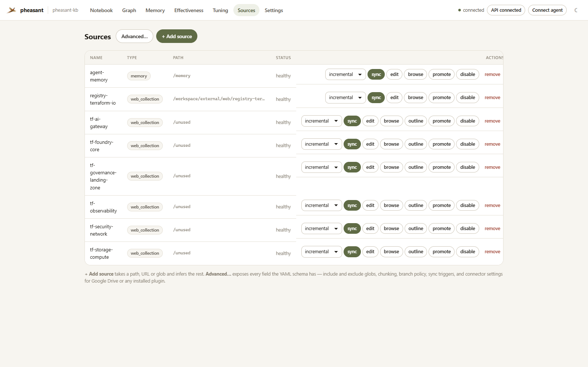
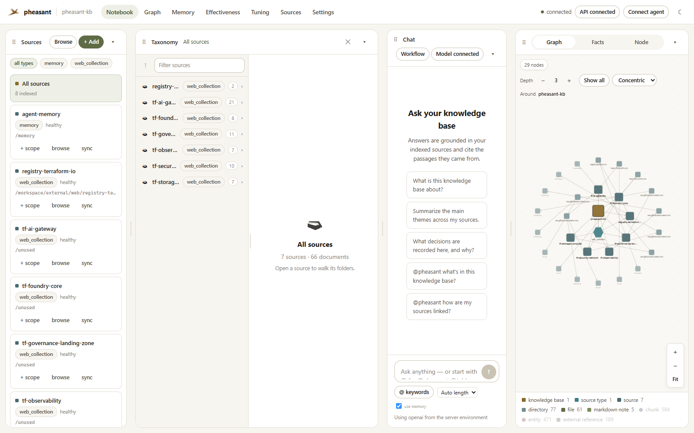
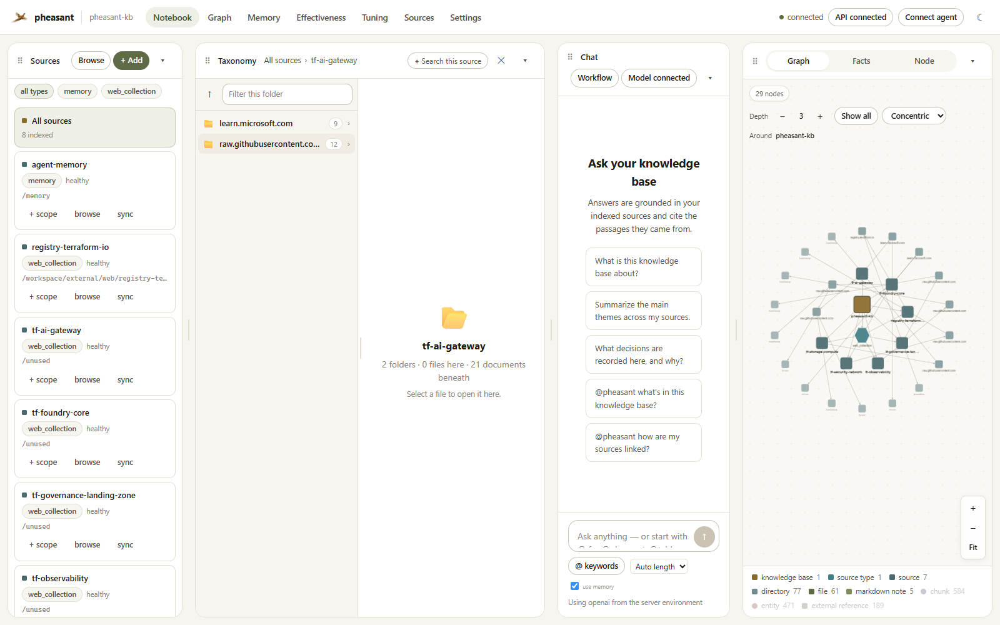
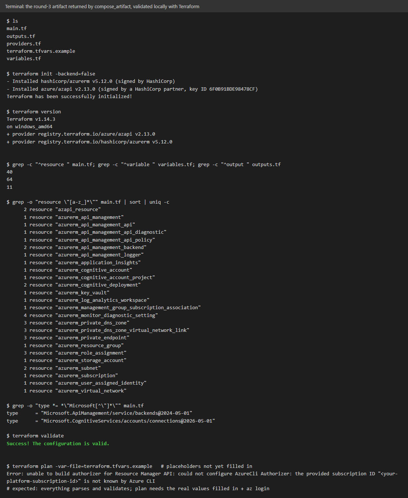

# Case study: an agent offloads a grounded AI platform build to pheasant-kb

**Date:** 2026-11-02 (UTC). **Build:** `pheasant:kb-gw12`, PR #126 head
(`e078e6e`), flagship stack (Postgres + pg_textsearch, NATS, gRPC workers,
`gpt-6-luna`).
**Who did what:** an external coding agent (Claude Code) connected to
pheasant-kb's MCP endpoint, and the region it called.
**Outcome:** three `compose_artifact` calls (one build, two revisions),
8.3 minutes of composition in all, produced a five-file, 40-resource Azure AI
platform behind an AI gateway. Every round passed `terraform validate` against
azurerm v5.12.0 and AzAPI v2.13.0; the final round also passes every design
check this case study set. The agent never read the 64 source documents; it
sent three requests (5.0 KB in all) and read three results (140 KB in all).

The interactive version is [`case-study.html`](case-study.html), one
self-contained file (download it and open it locally; it embeds the
screenshots, the requests and the artifact).

| Path | What it is |
|---|---|
| [`artifact/request-round1.txt`](artifact/request-round1.txt) … `round3.txt` | The three requests the agent sent, verbatim |
| [`artifact/mcp/`](artifact/mcp/) | The three `get_job` results, as the agent received them |
| [`artifact/*.tf`](artifact/), `terraform.tfvars.example` | The final round's five files, unedited |
| [`artifact/terraform-validate.txt`](artifact/terraform-validate.txt) | `terraform init` + `validate` (+ the `plan` stopping point) on those files |
| [`images/`](images/) | The corpus as the UI shows it, and the validation run |

Nothing here was deployed. The files are a validated starting point with
placeholder values, not a production configuration.

---

## 1. The idea: who should do the reading

Building this platform from documentation means reading about two dozen
reference pages plus the Microsoft Learn guidance that ties them together:
1.26 MB of source text across six collections. An agent can do that itself,
but every page it reads is context on its own (more expensive) model, and
nothing checks what it writes against the pages it skimmed.

`compose_artifact` splits the work along what each side is good at:

| The agent (Claude Code) | The region (pheasant-kb) |
|---|---|
| knows what to build and writes the request | plans one search per component and finds each component's own reference page |
| reviews the design and runs `terraform validate` | reads the evidence (45 documents in round 1), writes the whole artifact in one pass on `gpt-6-luna` |
| sends back what to change | checks every argument against its component's page, required arguments, undeclared references, invented types, omissions and purpose; corrects what it finds |

Grounded, because every resource, argument and value in the files is taken
from the indexed sources and cited (`# [n]`), and anything the sources leave
open is a placeholder variable listed in `not_covered`. Cheaper, because the
reading happens once, in the region, on the model it runs.

## 2. The corpus

Six web collections registered over MCP (`register_source`,
`edit_source_urls`), grouped by concern:

| Source | Docs | Covers |
|---|---|---|
| `tf-foundry-core` | 8 | Foundry account and project, cognitive deployments, CMK; the Learn Foundry/Terraform guide; the AVM module README |
| `tf-governance-landing-zone` | 11 | provider guides, resource group, subscription, management group and association, locks, data sources |
| `tf-observability` | 7 | Log Analytics, Application Insights, diagnostic settings, alerts, workbooks |
| `tf-security-network` | 10 | Key Vault, private endpoints, private DNS zones and links, VNet, subnet, identity, role assignment |
| `tf-storage-compute` | 7 | storage account, container, Container Apps, App Service |
| `tf-ai-gateway` | 21 | azurerm API Management (service, API, backend, policy, logger, diagnostic, …); AzAPI docs and the resource specs for the backend pool and Foundry connection; Learn's AI gateway, token-policy, backend and **managed-identity authentication** pages |

All azurerm pages are pinned to the v5.12.0 tag and the AzAPI specs to API
versions AzAPI v2.13.0 accepts. The managed-identity authentication page was
added during this session (§4): the corpus had no reference for that policy,
and the region said so rather than invent it.

## 3. The session

Following `.agents/skills/pheasant-compose/SKILL.md` step by step.

| Time (UTC) | Call | What happened |
|---|---|---|
| 00:45:36 | `compose_artifact(request, source_names=[6 tf-* sources])` | Returned job `28abc73713c5` at once. The request ([`artifact/request-round1.txt`](artifact/request-round1.txt), 2.6 KB) lists ten numbered requirements, each with its purpose, and six design conventions. |
| 00:46–00:50 | `get_job` (polled) | `progress.phase` walked plan → retrieve → decide while the writing call ran. |
| 00:50:41 | `get_job` → **succeeded** (5 min 5 s) | 25 queries, 157 passages, evidence sufficient (p=0.73), 45 documents read, written from 64 passages; the review found one design issue and edited the draft. Result 49.8 KB: five files, 32 citations, the trace, `not_covered`. |
| — | agent: `terraform validate` | **Passed**, 40 resource blocks. |
| — | agent: design review | Five things validate cannot see (§3.1). |
| 00:53:14 | `compose_artifact(request, previous_job="28abc73713c5")` | Only the five corrections were sent ([`artifact/request-round2.txt`](artifact/request-round2.txt), 1.5 KB); the region took the earlier artifact from its own job and **edited** it. |
| 00:55:10 | `get_job` → **succeeded** (1 min 56 s) | 12 queries planned around the changes, 33 documents read; review: nothing to correct; `dropped_from_previous: []`. |
| — | agent: `terraform validate` + review | **Passed**, 41 resource blocks. Review: one finding left (§3.1, item 6). |
| 02:04:14 | `compose_artifact(request, previous_job="98821274aaee")` | One correction ([`artifact/request-round3.txt`](artifact/request-round3.txt), 0.9 KB), stated as the problem and the outcome wanted. |
| 02:05:32 | `get_job` → **succeeded** (1 min 18 s) | 12 queries, 34 documents read; review: nothing to correct; `dropped_from_previous: []`. Two blocks of `main.tf` changed; every other line of every file is byte-identical to round 2. |
| — | agent: `terraform validate` + review | **Passed**, 40 resource blocks, 64 variables, 11 outputs; nothing left; every design check passes. |

### 3.1 What the agent's review caught (and validate could not)

1. The backend pool did not declare `type = "Pool"`, and its members'
   priority and weight defaulted to `-1`.
2. The gateway had no way to authenticate to Foundry: no managed identity on
   API Management, no role on the account, no authentication policy.
3. The Foundry connection's `target` and `authType` were free variables.
4. The primary backend URL was a free variable rather than the Foundry
   account's endpoint.
5. Three diagnostic settings set `log_analytics_destination_type`, which the
   documentation says is not configurable for Key Vault.

All five were corrected in round 2, each from the documentation (the pool
`type` and priorities from the backends spec, the policy from the
managed-identity reference, `authType` from the connections spec,
`gateway_url` from the API Management page). The second review found one
more:

6. The gateway's role assignment read
   `azurerm_api_management.gateway.identity[0].principal_id`, but the instance
   has only a user-assigned identity, so that attribute is empty and the
   assignment cannot be created. The round-2 request had asked for the
   principal ID "in the form the provider documentation's examples use", and
   those examples are for a system-assigned identity: a request leaning on a
   convention carried it to a case it does not fit.

Round 3 gave the Foundry role to the user-assigned identity whose
`client_id` the policy authenticates with, and removed the duplicate role
assignment for it.

### 3.2 The result

- **Gateway:** `azurerm_api_management` (StandardV2) with a user-assigned
  identity that holds a role on the Foundry account; an API importing the
  Foundry OpenAPI definition; an API policy that authenticates as that
  identity (`client-id`)
  (`authentication-managed-identity`), routes to the pool, and applies
  `llm-token-limit` and `llm-emit-token-metric`; two
  `azurerm_api_management_backend`s with circuit breakers, the primary on the
  Foundry endpoint and the secondary as failover; an AzAPI
  `Microsoft.ApiManagement/service/backends@2024-05-01` pool (`type =
  "Pool"`, priority 1 and 2); an Application Insights logger and API
  diagnostic; an AzAPI `Microsoft.CognitiveServices/accounts/connections@2026-05-01`
  of category `ApiManagement` targeting `gateway_url` + the API path with
  `authType = "ManagedIdentity"`.
- **Platform:** subscription alias placed under a management group, resource
  group, VNet with two subnets, three private endpoints each with its own
  DNS zone and VNet link, Key Vault (RBAC), storage, user-assigned identity
  with three role assignments (Foundry, Key Vault, storage), Foundry `AIServices` account, project and two
  deployments, Log Analytics, workspace-based Application Insights, four
  diagnostic settings.
- **Provider rule followed:** azurerm wherever it has a resource; AzAPI only
  for the pool and the connection.
- `terraform plan` stops at Azure authentication because the subscription ID
  is a placeholder, as expected. Nothing was deployed.

The files are in [`artifact/`](artifact/), the transcript in
[`artifact/terraform-validate.txt`](artifact/terraform-validate.txt), and
all three `get_job` results in [`artifact/mcp/`](artifact/mcp/).

## 4. What the test changed in pheasant

This was a test of whether the agent knows what to do and what compose can
do. The first attempts through the tool found nine things to fix; each is in
PR #126 with a test, and the session above ran on the build that has them.

| Found | Fix |
|---|---|
| Revising meant sending the previous 34 KB of files back | `previous_job`: the region reads the earlier artifact from its job |
| A revision was a regeneration: asked for five changes, it dropped the policy and both backends | A revision is an **edit of the draft** (`compose_draft`); `dropped_from_previous` reports anything lost |
| `get_job` showed one fixed phase for four minutes | Progress reports the workflow's own steps |
| The result (63 KB) exceeded one client's limit | Only cited passages; the request is not echoed back (~50 KB) |
| **`identity[0]` came back as `identity`** in every artifact that used it — the most frequent validate failure of the day, first blamed on the model | The verify step stripped `[0]` as a citation marker (passages are numbered from 1). Marker clean-up now touches prose only (`markup.outside_code`); conversation history had the same flaw |
| An artifact sent back in `history` was cut to 1,200 characters | The last turn's artifact is used as the draft, whole |
| One model call in eight failed on a TLS error and ended the job | A connection that fails before answering is retried twice |
| A failed run parsed quoted passages into files and listed every type as dropped | Files only from a written answer; dropped only against an artifact |
| No reference for the managed-identity policy, so the gateway could not authenticate | Corpus: the Learn `authentication-managed-identity` page added over MCP |

## 5. Limits

- **One session.** The three calls above are one run, not a reliability
  figure. Across the day, single compositions of this request validated in
  most runs, and the misses were exactly what §4 fixed; re-run before relying
  on it.
- **The review was the agent's.** Pheasant checks identifiers, references,
  required arguments, invented types and stated purposes; the six design
  findings in §3.1 came from the agent reading the result. A request that
  states those purposes up front needs fewer of them.
- **Validate is not plan or apply.** Values such as role names, DNS zone
  names and diagnostic categories are placeholders the reader fills in, and
  `not_covered` says so.
- **Jobs live in the API process.** A region restart loses them;
  `previous_job` then refuses and names the `history` route.
- **Latency.** A full composition takes about 5 minutes; a revision 1–2. Ordinary questions are unaffected (measured: p50 3.10 s against 3.34 s
  before, paired median −0.01 s).

## 6. Reproduce

1. Run PR #126's build: `docker build -t pheasant:kb-gw12 . &&
   PHEASANT_IMAGE=pheasant:kb-gw12 docker compose up -d`.
2. Register the six collections in §2 over MCP.
3. From an MCP client, follow the `pheasant-compose` skill: call
   `compose_artifact` with [`artifact/request-round1.txt`](artifact/request-round1.txt)
   and the six `source_names`, poll `get_job`, write the files out, run
   `terraform init -backend=false && terraform validate`, review, and revise
   with `previous_job` (the round-2 and round-3 requests are in `artifact/`).
